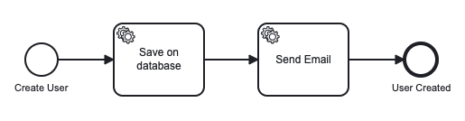

<div align="center">
    
    <h1>Tresdoce NestJS Toolkit<br/>Camunda</h1>
</div>

<div align="center">
    
    
    <br/>
    
    
    <br/>
</div>
<br/>

Este módulo está pensado para ser utilizado en [NestJS Starter](https://github.com/rudemex/nestjs-starter), o cualquier
proyecto que utilice una configuración centralizada, siguiendo la misma arquitectura del starter.

Convierte una aplicación NestJS en un **worker de tareas externas de Camunda 7** (Camunda Platform / CIBSEVEN) usando
[camunda-external-task-client-js](https://github.com/camunda/camunda-external-task-client-js). Expone una
`CustomTransportStrategy` de NestJS microservices (`CamundaTaskConnector`) y el decorador `@Subscription`, de modo que cada
_service task_ de tipo `external` de un proceso BPMN se resuelve con un método de un controller, con soporte de pipes,
guards, interceptors y exception filters de Nest.

Usalo cuando tus procesos BPMN delegan trabajo en _external tasks_ (patrón _fetch & lock_ sobre la API REST del engine).
No sirve para Camunda 8 / Zeebe.

## Glosario

- [📝 Requerimientos básicos](#basic-requirements)
- [🛠️ Instalar dependencia](#install-dependencies)
- [⚙️ Configuración](#configurations)
- [🐳 Camunda local con Docker](#docker)
- [👨‍💻 Uso](#use)
- [🤓 Ejemplo](#example)
- [📖 API Reference](#api-reference)
- [📄 Changelog](./CHANGELOG.md)
- [📜 License MIT](./license.md)

---

<a name="basic-requirements"></a>

## 📝 Requerimientos básicos

- [NestJS Starter](https://github.com/rudemex/nestjs-starter)
- Node.js v22.22 or higher ([Download](https://nodejs.org/es/download/))
- YARN ≥ 1.22.22 o NPM ≥ 11.6.4
- NestJS v12 or higher ([Documentación](https://nestjs.com/))
- Un engine de Camunda 7 con la API REST habilitada (ver [Camunda local con Docker](#docker))

<a name="install-dependencies"></a>

## 🛠️ Instalar dependencia

```
npm install -S @tresdoce-nestjs-toolkit/camunda
```

```
yarn add @tresdoce-nestjs-toolkit/camunda
```

El paquete es **ESM-only** y depende de `@nestjs/microservices`, `camunda-external-task-client-js` y `rxjs`.

## 📦 Dependencias internas

Este paquete no tiene dependencias internas del toolkit. Puede utilizarse de forma independiente.

<a name="configurations"></a>

## ⚙️ Configuración

El módulo lee la configuración del key `config.camunda` del `ConfigService` (`Typings.AppConfig['camunda']`, de tipo
`CamundaOptions`, que es el `ClientConfig` del SDK). Agregá los datos de conexión en `configuration.ts`:

```typescript
//./src/config/configuration.ts
import type { Typings } from '@tresdoce-nestjs-toolkit/core';
import { registerAs } from '@nestjs/config';
import { BasicAuthInterceptor, logger } from '@tresdoce-nestjs-toolkit/camunda';

export default registerAs('config', (): Typings.AppConfig => {
  return {
    //...
    camunda: {
      baseUrl: process.env.CAMUNDA_URL_REST || 'http://localhost:8443/engine-rest',
      workerId: process.env.CAMUNDA_WORKER_ID || 'my-app-worker',
      maxTasks: 10,
      lockDuration: 50000,
      // Solo si el engine tiene autenticación habilitada
      interceptors: new BasicAuthInterceptor({
        username: process.env.CAMUNDA_USERNAME || 'demo',
        password: process.env.CAMUNDA_PASSWORD || 'demo',
      }),
      // Logs del cliente (suscripciones, polling, complete, failures...)
      use: logger,
    },
    //...
  };
});
```

Variables de entorno sugeridas:

```dotenv
CAMUNDA_URL_REST=http://localhost:8443/engine-rest
CAMUNDA_WORKER_ID=my-app-worker
CAMUNDA_USERNAME=demo
CAMUNDA_PASSWORD=demo
```

<details>
<summary>💬 Para ver en detalle todas las propiedades de la configuración, hace clic acá.</summary>

`baseUrl`: Ruta de acceso a la API REST de Camunda.

- Type: `String`
- Required: `true`

`workerId`: Es el ID del worker. Las tareas devueltas quedan bloqueadas para ese worker y solo pueden completarse si se
proporciona el mismo `workerId`.

- Type: `String`
- Required: `false`
- Default: `some-random-id`

`maxTasks`: Número máximo de tareas a recuperar por ciclo de polling.

- Type: `Number`
- Required: `false`
- Default: `10`

`maxParallelExecutions`: Número máximo de tareas en las que se puede trabajar simultáneamente.

- Type: `Number`
- Required: `false`

`interval`: Intervalo de tiempo en milisegundos entre ciclos de polling.

- Type: `Number`
- Required: `false`
- Default: `300`

`lockDuration`: Duración por defecto para bloquear las tareas externas en milisegundos. Se puede sobreescribir por
tópico desde `@Subscription`.

- Type: `Number`
- Required: `false`
- Default: `50000`

`autoPoll`: **Se ignora.** El `CamundaTaskConnector` crea el cliente con `autoPoll: false` e inicia el polling recién
cuando NestJS levanta el microservicio (`app.startAllMicroservices()`), después de registrar todas las suscripciones.

- Type: `Boolean`
- Required: `false`

`asyncResponseTimeout`: Tiempo de espera del long polling en milisegundos.

- Type: `Number`
- Required: `false`

`usePriority`: Si es `false`, las tareas se obtendrán arbitrariamente en lugar de basarse en su prioridad.

- Type: `Boolean`
- Required: `false`
- Default: `true`

`interceptors`: Función o array de funciones llamadas antes de enviar cada solicitud. Reciben la configuración de la
solicitud y devuelven una nueva configuración (ej. `BasicAuthInterceptor`).

- Type: `Function | Function[]`
- Required: `false`

`use`: Función o array de funciones que reciben la instancia del cliente apenas se crea y antes de cualquier polling. Es
el punto de extensión para middlewares como el `logger` incluido en el paquete.

- Type: `Function | Function[]`
- Required: `false`

Para más información sobre los parámetros de conexión, consultar la
[documentación de Camunda](https://github.com/camunda/camunda-external-task-client-js/blob/master/docs/Client.md#new-clientoptions).

</details>

<a name="docker"></a>

## 🐳 Camunda local con Docker

Para desarrollo local alcanza con Camunda 7 Run (engine + REST API + Cockpit/Tasklist, con base H2 en memoria):

```yaml
# ./docker-compose.yml
services:
  camunda:
    image: camunda/camunda-bpm-platform:run-7.24.0
    container_name: camunda
    ports:
      - '8443:8080'
    environment:
      TZ: America/Argentina/Buenos_Aires
    healthcheck:
      test: ['CMD-SHELL', 'wget -qO- http://localhost:8080/engine-rest/engine || exit 1']
      interval: 10s
      timeout: 5s
      retries: 10
```

```sh
docker compose up -d camunda
```

- Welcome: `http://localhost:8443/camunda-welcome/index.html` (user: `demo` / pass: `demo`)
- Cockpit / Tasklist: `http://localhost:8443/camunda/app/`
- API REST: `http://localhost:8443/engine-rest` (Swagger UI en `http://localhost:8443/swaggerui/`)

Los procesos se pueden desplegar desde Camunda Modeler o con la API REST:

```sh
curl -X POST http://localhost:8443/engine-rest/deployment/create \
  -F deployment-name=create-user \
  -F data=@create-user.bpmn
```

<a name="use"></a>

## 👨‍💻 Uso

### 1. Importar el módulo

`CamundaModule` está marcado como `@Global()`: importalo una sola vez en `AppModule`. Registra y exporta el
`CamundaTaskConnector`, construido con la configuración de `config.camunda`.

```typescript
//./src/app.module.ts
import { Module } from '@nestjs/common';
import { CamundaModule } from '@tresdoce-nestjs-toolkit/camunda';

@Module({
  imports: [
    //...
    CamundaModule,
    //...
  ],
})
export class AppModule {}
```

### 2. Conectar el microservicio en `main.ts`

`CamundaTaskConnector` implementa `CustomTransportStrategy`. Conectalo como microservicio: al ejecutar
`app.startAllMicroservices()` suscribe todos los handlers y arranca el polling; al cerrar la app (`app.close()`, con
`enableShutdownHooks()` para señales del SO) detiene el cliente.

```typescript
//./src/main.ts
import { NestFactory } from '@nestjs/core';
import { CamundaTaskConnector } from '@tresdoce-nestjs-toolkit/camunda';
import { AppModule } from './app.module.js';

async function bootstrap() {
  const app = await NestFactory.create(AppModule);
  app.enableShutdownHooks();

  app.connectMicroservice({ strategy: app.get(CamundaTaskConnector) }, { inheritAppConfig: true });
  await app.startAllMicroservices();

  await app.listen(3000);
}
bootstrap();
```

> `inheritAppConfig: true` hace que los pipes, interceptors, guards y filters globales de la app también apliquen a los
> handlers de Camunda.

Logs de arranque:

```
[Nest] 12345  - LOG [CamundaTaskConnector] External Task Client started
✓ subscribed to topic save-database        <- solo con `use: logger`
✓ subscribed to topic send-email
```

### 3. Suscribirse a tópicos con `@Subscription`

`@Subscription(topic, options?)` registra un método como handler de un tópico. Internamente es un `@MessagePattern(topic)`
de NestJS microservices; las opciones viajan en los _extras_ del pattern y se pasan sin modificar a `client.subscribe`.

El método recibe el `task` con `@Payload()` y el `taskService` con `@Ctx()`, que se usa para completar, fallar o lanzar
un error BPMN.

```typescript
import { Controller, Logger } from '@nestjs/common';
import { Ctx, Payload } from '@nestjs/microservices';
import {
  Subscription,
  Variables,
  type Task,
  type TaskService,
} from '@tresdoce-nestjs-toolkit/camunda';

@Controller()
export class ProcessController {
  private readonly logger = new Logger(ProcessController.name);

  @Subscription('save-database', { lockDuration: 10000, variables: ['username', 'email'] })
  async saveDatabase(@Payload() task: Task, @Ctx() taskService: TaskService): Promise<void> {
    const username: string = task.variables.get('username');
    const email: string = task.variables.get('email');

    try {
      // Lógica de negocio...
      const processVariables = new Variables().set('userId', 123);
      await taskService.complete(task, processVariables);
      this.logger.log(`Task ${task.id} completed (${username} <${email}>)`);
    } catch (error) {
      await taskService.handleFailure(task, {
        errorMessage: error.message,
        errorDetails: error.stack,
        retries: 0,
        retryTimeout: 1000,
      });
    }
  }

  @Subscription('validate-user')
  async validateUser(@Payload() task: Task, @Ctx() taskService: TaskService): Promise<void> {
    if (!task.variables.get('email')) {
      // Dispara un Error Boundary Event en el modelo BPMN
      await taskService.handleBpmnError(task, 'INVALID_USER', 'El email es obligatorio');
      return;
    }
    await taskService.complete(task);
  }
}
```

Objeto `task` recibido (resumido):

```json
{
  "id": "6f6b2c3e-91d6-11ef-a9d2-0242ac110002",
  "topicName": "save-database",
  "workerId": "my-app-worker",
  "processDefinitionKey": "create-user",
  "processInstanceId": "6f5d3d1a-91d6-11ef-a9d2-0242ac110002",
  "activityId": "Activity_SaveDatabase",
  "businessKey": null,
  "retries": null,
  "priority": 0,
  "lockExpirationTime": "2026-10-25T22:10:00.000-0300",
  "variables": "Variables { get(name), getAll(), getTyped(name), ... }"
}
```

#### Manejo de errores

Si el handler lanza una excepción (o devuelve un Observable con error), la promesa que recibe el cliente se rechaza: el
error lo loguea el `RpcExceptionsHandler` de Nest (o tus exception filters) y el cliente emite el evento
`handler:error`. **La tarea no se marca como fallida en Camunda**: queda bloqueada hasta que vence `lockDuration` y
vuelve a estar disponible. Para registrar un incidente usá `taskService.handleFailure(...)` y para un error de negocio
`taskService.handleBpmnError(...)`.

```
[Nest] 12345  - ERROR [RpcExceptionsHandler] Error: boom
    at ProcessController.saveDatabase (...)
```

#### Usar `@MessagePattern` directamente

También se puede usar `@MessagePattern('topic')` de `@nestjs/microservices`: el pattern se toma como nombre del tópico,
sin opciones. Por compatibilidad hacia atrás se sigue aceptando `@MessagePattern({ topic, options })`.

### 4. Acceder al cliente

`CamundaTaskConnector` se puede inyectar en cualquier provider; `unwrap()` devuelve el `Client` del SDK, por ejemplo
para escuchar eventos:

```typescript
import { Injectable, Logger, OnModuleInit } from '@nestjs/common';
import { CamundaTaskConnector, type Client } from '@tresdoce-nestjs-toolkit/camunda';

@Injectable()
export class CamundaEventsService implements OnModuleInit {
  constructor(private readonly connector: CamundaTaskConnector) {}

  onModuleInit() {
    const client = this.connector.unwrap<Client>();
    client.on('poll:error', (error) => Logger.error(error, 'Camunda'));
    client.on('complete:success', (task) => Logger.log(`completed ${task.id}`, 'Camunda'));
  }
}
```

<a name="example"></a>

## 🤓 Ejemplo

> Nota: El siguiente ejemplo ilustra el uso del módulo junto con Camunda. No incluye el scope completo (integración a
> BD, envío de mail, DTOs de request, etc.).

Para este ejemplo se trabaja un proceso BPMN sencillo para la creación de un usuario, con dos _external tasks_ con los
tópicos `save-database` y `send-email`.

Puedes descargar el proceso BPMN
haciendo [clic acá](https://raw.githubusercontent.com/tresdoce/tresdoce-nestjs-toolkit/master/packages/camunda/.readme-static/create-user.bpmn)
o [acá](./.readme-static/create-user.bpmn), y desplegarlo con el `curl` de la sección [Docker](#docker).

<div align="center">
    
</div>

```typescript
import { Controller, HttpException, Logger, Post } from '@nestjs/common';
import { Ctx, Payload } from '@nestjs/microservices';
import { HttpClientService } from '@tresdoce-nestjs-toolkit/http-client';
import { Subscription, type Task, type TaskService } from '@tresdoce-nestjs-toolkit/camunda';

@Controller('users')
export class UsersController {
  private readonly logger = new Logger(UsersController.name);

  constructor(private readonly httpClient: HttpClientService) {}

  // Inicia una instancia del proceso por API REST
  @Post()
  async createUser() {
    try {
      const { data } = await this.httpClient.post(
        'http://localhost:8443/engine-rest/process-definition/key/create-user/start',
        {
          data: {
            variables: {
              username: { value: 'juan', type: 'String' },
              email: { value: 'juan@email.com', type: 'String' },
            },
          },
        },
      );
      return data;
    } catch (error) {
      throw new HttpException(error.message, error.response?.status ?? 500);
    }
  }

  @Subscription('save-database')
  async saveDatabase(@Payload() task: Task, @Ctx() taskService: TaskService) {
    try {
      // Código para guardar en la BD...
      await taskService.complete(task);
      this.logger.log(`save-database completed for ${task.variables.get('username')}`);
    } catch (error) {
      await taskService.handleFailure(task, { errorMessage: error.message });
    }
  }

  @Subscription('send-email')
  async sendEmail(@Payload() task: Task, @Ctx() taskService: TaskService) {
    try {
      // Código para enviar un mail...
      await taskService.complete(task);
      this.logger.log(`send-email completed for ${task.variables.get('email')}`);
    } catch (error) {
      await taskService.handleFailure(task, { errorMessage: error.message });
    }
  }
}
```

Respuesta de `POST /users` (la devuelve el engine al iniciar la instancia):

```json
{
  "links": [
    {
      "method": "GET",
      "href": "http://localhost:8443/engine-rest/process-instance/6f5d3d1a-91d6-11ef-a9d2-0242ac110002",
      "rel": "self"
    }
  ],
  "id": "6f5d3d1a-91d6-11ef-a9d2-0242ac110002",
  "definitionId": "create-user:1:5b1e2f4c-91d6-11ef-a9d2-0242ac110002",
  "businessKey": null,
  "caseInstanceId": null,
  "ended": false,
  "suspended": false,
  "tenantId": null
}
```

Logs del worker:

```
[Nest] 12345  - LOG [UsersController] save-database completed for juan
✓ completed task 6f6b2c3e-91d6-11ef-a9d2-0242ac110002      <- con `use: logger`
[Nest] 12345  - LOG [UsersController] send-email completed for juan@email.com
✓ completed task 7a1c0b52-91d6-11ef-a9d2-0242ac110002
```

<a name="api-reference"></a>

## 📖 API Reference

### Exports

| Export                       | Tipo      | Descripción                                                                   |
| ---------------------------- | --------- | ----------------------------------------------------------------------------- |
| `CamundaModule`              | Módulo    | Módulo global que registra y exporta `CamundaTaskConnector`.                  |
| `CamundaTaskConnector`       | Provider  | `CustomTransportStrategy` que conecta los handlers de Nest con el cliente.    |
| `Subscription`               | Decorador | Registra un método como handler de un tópico.                                 |
| `CamundaOptions`             | Tipo      | Alias de `ClientConfig`; forma de `Typings.AppConfig['camunda']`.             |
| `Client`                     | Clase     | Cliente del SDK (re-export del default export de la librería CommonJS).       |
| `Variables`                  | Clase     | Manejo de variables de proceso/locales.                                       |
| `BasicAuthInterceptor`       | Clase     | Interceptor de autenticación HTTP Basic para `interceptors`.                  |
| `logger`                     | Función   | Middleware de logging para `use` (nivel `info`).                              |
| `ClientConfig`               | Tipo      | Configuración del cliente.                                                    |
| `BasicAuthInterceptorConfig` | Tipo      | `{ username, password }`.                                                     |
| `Task`                       | Tipo      | Tarea externa recibida en el handler.                                         |
| `TaskService`                | Tipo      | `complete`, `handleFailure`, `handleBpmnError`, `extendLock`, `unlock`, ...   |
| `HandleFailureOptions`       | Tipo      | `{ errorMessage?, errorDetails?, retries?, retryTimeout? }`.                  |
| `SubscribeOptions`           | Tipo      | Opciones de suscripción a un tópico.                                          |
| `TopicSubscription`          | Tipo      | Suscripción devuelta por `client.subscribe`.                                  |
| `TypedValue`                 | Tipo      | Valor tipado de una variable.                                                 |
| `HandlerArgs`                | Tipo      | `{ task, taskService }`.                                                      |
| `Logger`                     | Tipo      | Tipo del `logger` del SDK (no confundir con el `Logger` de `@nestjs/common`). |

> `camunda-external-task-client-js` es CommonJS y Node solo detecta `Client` como named export; por eso este paquete
> re-exporta `Client`, `Variables`, `BasicAuthInterceptor` y `logger` ya resueltos. Importalos siempre desde
> `@tresdoce-nestjs-toolkit/camunda`.

---

### `CamundaTaskConnector`

| Miembro               | Descripción                                                                                                |
| --------------------- | ---------------------------------------------------------------------------------------------------------- |
| `listen(callback)`    | Suscribe todos los handlers registrados y arranca el polling. Lo invoca Nest en `startAllMicroservices()`. |
| `close()`             | Detiene el polling (`client.stop()`). Lo invoca Nest al cerrar la app.                                     |
| `unwrap<T>()`         | Devuelve la instancia interna del `Client`.                                                                |
| `on(event, callback)` | Requerido por `Server`; solo loguea el evento. Para eventos del cliente usá `unwrap<Client>().on(...)`.    |

---

### `@Subscription(topic: string, options?: SubscribeOptions)`

| Parámetro | Tipo               | Requerido | Descripción                                      |
| --------- | ------------------ | :-------: | ------------------------------------------------ |
| `topic`   | `string`           |    Si     | Nombre del tópico de la tarea externa en Camunda |
| `options` | `SubscribeOptions` |    No     | Opciones de suscripción                          |

`SubscribeOptions`:

| Opción                            | Tipo                   | Descripción                                                       |
| --------------------------------- | ---------------------- | ----------------------------------------------------------------- |
| `lockDuration`                    | `number`               | Bloqueo de la tarea en ms (por defecto el `lockDuration` global). |
| `variables`                       | `string[]`             | Variables a traer con la tarea (por defecto, todas).              |
| `localVariables`                  | `boolean`              | Trae solo variables locales.                                      |
| `businessKey`                     | `string`               | Filtra por business key.                                          |
| `processDefinitionId`/`...IdIn`   | `string`               | Filtra por definición de proceso.                                 |
| `processDefinitionKey`/`...KeyIn` | `string`               | Filtra por key de definición de proceso.                          |
| `processDefinitionVersionTag`     | `string`               | Filtra por version tag.                                           |
| `processVariables`                | `object`               | Filtra por valores de variables de proceso.                       |
| `tenantIdIn` / `withoutTenantId`  | `string[]` / `boolean` | Filtros multi-tenant.                                             |

## 📄 Changelog

Todos los cambios notables de este paquete se documentarán en el archivo [Changelog](./CHANGELOG.md).

---

<div align="center">
    <a href="mailto:mdelgado@tresdoce.com.ar" target="_blank" alt="Send an email">
        
    </a><br/>
    <p>Made with ❤</p>
</div>
