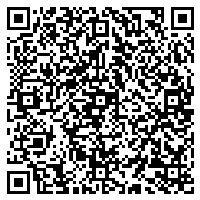
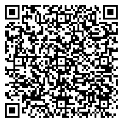
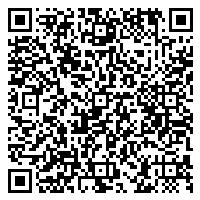

<div align="center">
    
    <h1>Tresdoce NestJS Toolkit<br/>QrCode</h1>
</div>

<div align="center">
    
    
    <br/>
    
    
    <br/>
</div>
<br/>

Este módulo está pensado para ser utilizado en [NestJS Starter](https://github.com/rudemex/nestjs-starter), o cualquier
proyecto que utilice una configuración centralizada, siguiendo la misma arquitectura del starter.

## Glosario

- [🥳 Demo](https://nestjs-starter.tresdoce.com.ar/v1/docs)
- [📝 Requerimientos básicos](#basic-requirements)
- [🛠️ Instalar dependencia](#install-dependencies)
- [👨‍💻 Uso](#use)
- [📖 API Reference](#api-reference)
- [📄 Changelog](./CHANGELOG.md)
- [📜 License MIT](./license.md)

---

<a name="basic-requirements"></a>

## 📝 Requerimientos básicos

- [NestJS Starter](https://github.com/rudemex/nestjs-starter)
- Node.js v22.22 or higher ([Download](https://nodejs.org/es/download/))
- YARN ≥ 1.22.22 o NPM ≥ 11.6.4
- NestJS v12 or higher ([Documentación](https://nestjs.com/))

<a name="install-dependencies"></a>

## 🛠️ Instalar dependencia

```
npm install -S @tresdoce-nestjs-toolkit/qrcode
```

```
yarn add @tresdoce-nestjs-toolkit/qrcode
```

## 📦 Dependencias internas

Este paquete no tiene dependencias internas del toolkit. Puede utilizarse de forma independiente.

<a name="use"></a>

## 👨‍💻 Uso

Este paquete envuelve la librería [`qrcode`](https://www.npmjs.com/package/qrcode) en un servicio inyectable de NestJS
(`QrCodeService`) que arma el contenido del QR a partir de un objeto tipado (texto, URL, WiFi, vCard, email, SMS,
WhatsApp, geolocalización, evento o criptomoneda) y lo devuelve listo para responder por HTTP.

Usalo cuando necesites generar códigos QR del lado del servidor, por ejemplo para devolver una imagen PNG desde un
endpoint, embeber el QR en un HTML/email como data URL o adjuntarlo a un PDF.

`QrCodeService` expone dos métodos:

- `createQrCode()` — genera el QR y lo retorna como **data URL PNG en base64** (`data:image/png;base64,...`).
- `createQrCodeBuffer()` — genera el QR y lo retorna como **Buffer PNG**.

> No requiere configuración: el módulo no lee ninguna key de `Typings.AppConfig` ni variables de entorno, y no
> depende de servicios externos.

### Importación del módulo

`QrCodeModule` es `@Global()`, por lo que basta con importarlo una sola vez en el módulo raíz.

```typescript
// ./src/app.module.ts
import { Module } from '@nestjs/common';
import { QrCodeModule } from '@tresdoce-nestjs-toolkit/qrcode';

@Module({
  imports: [
    QrCodeModule,
    //...
  ],
})
export class AppModule {}
```

Alternativamente, se puede registrar el servicio directamente en los `providers` de cualquier módulo:

```typescript
import { Module } from '@nestjs/common';
import { QrCodeService } from '@tresdoce-nestjs-toolkit/qrcode';

@Module({
  providers: [QrCodeService],
  exports: [QrCodeService],
})
export class MyModule {}
```

### Services

```typescript
// ./src/app.service.ts
import { Injectable } from '@nestjs/common';
import { QrCodeService } from '@tresdoce-nestjs-toolkit/qrcode';

@Injectable()
export class AppService {
  constructor(private readonly qrCodeService: QrCodeService) {}

  // Genera el QR como data URL PNG en base64 (300px)
  async createQrCodeUrl(): Promise<string> {
    return this.qrCodeService.createQrCode({ type: 'text', text: 'Hola Mundo' }, { width: 300 });
  }

  // Genera el QR como Buffer PNG (300px)
  async createQrCodeBuffer(): Promise<Buffer> {
    return this.qrCodeService.createQrCodeBuffer(
      { type: 'url', url: 'https://www.ejemplo.com' },
      { width: 300, color: { dark: '#000000', light: '#FFFFFF' } },
    );
  }
}
```

### Controllers

```typescript
// ./src/app.controller.ts
import { Controller, Get, Header, StreamableFile } from '@nestjs/common';
import { AppService } from './app.service.js';

@Controller()
export class AppController {
  constructor(private readonly appService: AppService) {}

  // Retorna un JSON con la data URL del QR
  @Get('qr-code-url')
  async createQrCodeUrl() {
    return { qrCode: await this.appService.createQrCodeUrl() };
  }

  // Retorna la imagen PNG del QR
  @Get('qr-code-buffer')
  @Header('Content-Type', 'image/png')
  async createQrCodeBuffer(): Promise<StreamableFile> {
    return new StreamableFile(await this.appService.createQrCodeBuffer());
  }
}
```

Si preferís manejar la respuesta de Express directamente:

```typescript
import { Get, Res } from '@nestjs/common';
import type { Response } from 'express';

@Get('qr-code-image')
async qrCodeImage(@Res() response: Response) {
  const qrCode = await this.appService.createQrCodeBuffer();
  response.status(200).type('image/png').send(qrCode);
}
```

### Ejemplos de respuesta

**`createQrCode()`** — `GET /qr-code-url`

```json
{
  "qrCode": "data:image/png;base64,iVBORw0KGgoAAAANSUhEUgAAAMgAAADICAYAAACtWK6eAAAA..."
}
```

La data URL se puede usar directamente en HTML: ``.

**`createQrCodeBuffer()`** — `GET /qr-code-buffer`

```
HTTP/1.1 200 OK
Content-Type: image/png

<binario PNG>
```

El objeto devuelto por el servicio es un `Buffer` con la firma PNG:

```typescript
<Buffer 89 50 4e 47 0d 0a 1a 0a 00 00 00 0d 49 48 44 52 ...>
```

**Errores** — ambos métodos rechazan la promesa con un `Error` cuyo mensaje lleva el prefijo
`Error creating QR code:` (y `[Buffer] ` en `createQrCodeBuffer`). El error original queda disponible en `error.cause`.

```typescript
await qrCodeService.createQrCode({ type: 'url', url: 'invalid-url' });
// Error: Error creating QR code: URL not valid

await qrCodeService.createQrCodeBuffer({ type: 'foo' } as any);
// Error: [Buffer] Error creating QR code: [Buffer] Invalid QR Code data type
```

> Son `Error` nativos (no `HttpException`): si los dejás propagar, Nest responde `500`. Capturalos y relanzalos como
> `BadRequestException` si el dato proviene del cliente.

### Tipos de código QR

El parámetro `data` es un objeto tipado (`QRCodeData`) que determina el contenido del QR. Para cada tipo se muestra el
texto que finalmente se codifica.

##### Texto plano

```typescript
createQrCode({ type: 'text', text: 'Hola Mundo' });
// Contenido: Hola Mundo
```

<div align="center">
    
</div>

##### URL

La URL es validada (`URL.canParse`) antes de generar el QR. Si no es válida, se lanza el error `URL not valid`.

```typescript
createQrCode({ type: 'url', url: 'https://www.ejemplo.com' });
// Contenido: https://www.ejemplo.com
```

<div align="center">
    
</div>

##### WIFI

Los caracteres especiales (`\ ; , : "`) del SSID y la contraseña se escapan automáticamente. Para redes abiertas usá
`encryption: 'nopass'` (la contraseña se omite) y para redes ocultas `hidden: true`.

```typescript
createQrCode({
  type: 'wifi',
  ssid: 'MiWifi',
  password: 'password123',
  encryption: 'WPA', // 'WEP' | 'WPA' | 'WPA2' | 'nopass'
});
// Contenido: WIFI:T:WPA;S:MiWifi;P:password123;;

createQrCode({ type: 'wifi', ssid: 'Invitados', encryption: 'nopass', hidden: true });
// Contenido: WIFI:T:nopass;S:Invitados;H:true;;
```

<div align="center">
    
</div>

##### vCard

Genera una vCard 3.0. `name` y `organization` se escapan según RFC 6350 (`,`, `;`, `\` y saltos de línea).

```typescript
createQrCode({
  type: 'vcard',
  name: 'Juan Perez',
  phone: '+34123456789',
  email: 'juan.perez@ejemplo.com',
  organization: 'Ejemplo S.A.',
});
// Contenido:
// BEGIN:VCARD
// VERSION:3.0
// FN:Juan Perez
// ORG:Ejemplo S.A.
// TEL:+34123456789
// EMAIL:juan.perez@ejemplo.com
// END:VCARD
```

<div align="center">
    
</div>

##### Email

```typescript
createQrCode({
  type: 'email',
  address: 'info@ejemplo.com',
  subject: 'Saludos',
  body: 'Hola, este es un email de ejemplo.',
});
// Contenido: mailto:info@ejemplo.com?subject=Saludos&body=Hola%2C%20este%20es%20un%20email%20de%20ejemplo.
```

<div align="center">
    
</div>

##### SMS

```typescript
createQrCode({
  type: 'sms',
  phone: '+34123456789',
  message: 'Hola, ¿cómo estás?',
});
// Contenido: SMSTO:+34123456789:Hola, ¿cómo estás?
```

<div align="center">
    
</div>

##### Whatsapp

Del teléfono se conservan solo los dígitos (formato internacional que requiere `wa.me`).

```typescript
createQrCode({
  type: 'whatsapp',
  phone: '+54 9 11 1234-5678',
  message: 'Hola, ¿cómo estás?',
});
// Contenido: https://wa.me/5491112345678?text=Hola%2C%20%C2%BFc%C3%B3mo%20est%C3%A1s%3F
```

<div align="center">
    
</div>

##### Geolocalización

```typescript
createQrCode({
  type: 'geo',
  latitude: -34.6395141,
  longitude: -58.4022226,
});
// Contenido: geo:-34.6395141,-58.4022226
```

<div align="center">
    
</div>

##### Evento de calendario

Las fechas deben estar en formato iCal UTC (`YYYYMMDDTHHmmssZ`). `summary` se escapa según RFC 5545.

```typescript
createQrCode({
  type: 'event',
  summary: 'Reunión de Trabajo',
  start: '20261015T170000Z',
  end: '20261015T190000Z',
});
// Contenido:
// BEGIN:VEVENT
// SUMMARY:Reunión de Trabajo
// DTSTART:20261015T170000Z
// DTEND:20261015T190000Z
// END:VEVENT
```

<div align="center">
    
</div>

##### Criptomoneda

La moneda se normaliza a minúsculas.

```typescript
createQrCode({
  type: 'crypto',
  currency: 'Bitcoin',
  address: '1BoatSLRHtKNngkdXEeobR76b53LETtpyT',
});
// Contenido: bitcoin:1BoatSLRHtKNngkdXEeobR76b53LETtpyT
```

<div align="center">
    
</div>

### Uso directo de la librería `qrcode`

Las funciones de `qrcode` se re-exportan, por lo que se pueden usar sin instalar la librería aparte, por ejemplo para
generar un SVG:

```typescript
import { toString } from '@tresdoce-nestjs-toolkit/qrcode';

const svg = await toString('Hola Mundo', { type: 'svg' });
// '<svg xmlns="http://www.w3.org/2000/svg" viewBox="0 0 29 29" shape-rendering="crispEdges">...'
```

<a name="api-reference"></a>

## 📖 API Reference

### `QrCodeModule`

Módulo global (`@Global()`). Provee y exporta `QrCodeService`. No tiene `forRoot`/`register` ni opciones.

### `QrCodeService`

| Método               | Firma                                                                     | Descripción                           |
| -------------------- | ------------------------------------------------------------------------- | ------------------------------------- |
| `createQrCode`       | `(data: QRCodeData, options?: QRCodeToDataURLOptions) => Promise<string>` | Genera un QR como data URL PNG base64 |
| `createQrCodeBuffer` | `(data: QRCodeData, options?: QRCodeToBufferOptions) => Promise<Buffer>`  | Genera un QR como Buffer PNG          |

Las `options` se combinan (shallow merge) con las opciones por defecto.

### Opciones por defecto

**`createQrCode` (`DEFAULT_QRCODE_OPTIONS_URL`):**

| Opción                 | Valor por defecto |
| ---------------------- | ----------------- |
| `type`                 | `'image/png'`     |
| `errorCorrectionLevel` | `'H'`             |
| `width`                | `200`             |
| `margin`               | `2`               |

> En Node.js `qrcode` solo genera data URLs PNG: `type: 'image/jpeg' | 'image/webp'` y `rendererOpts.quality` solo
> tienen efecto en el navegador (canvas) y se ignoran del lado del servidor.

**`createQrCodeBuffer` (`DEFAULT_QRCODE_OPTIONS_BUFFER`):**

| Opción                 | Valor por defecto |
| ---------------------- | ----------------- |
| `type`                 | `'png'`           |
| `errorCorrectionLevel` | `'H'`             |
| `width`                | `200`             |
| `margin`               | `2`               |

Otras opciones útiles: `scale`, `color.dark`, `color.light`, `version`, `maskPattern`. Ver
[QRCode - Options](https://www.npmjs.com/package/qrcode#qr-code-options).

### Interfaces de tipos QR

| Interfaz      | Campo `type` | Campos                                                                                                      |
| ------------- | ------------ | ----------------------------------------------------------------------------------------------------------- |
| `PlainTextQR` | `'text'`     | `text: string`                                                                                              |
| `URLQR`       | `'url'`      | `url: string`                                                                                               |
| `WiFiQR`      | `'wifi'`     | `ssid: string`, `password?: string`, `encryption: 'WEP' \| 'WPA' \| 'WPA2' \| 'nopass'`, `hidden?: boolean` |
| `VCardQR`     | `'vcard'`    | `name: string`, `organization: string`, `phone: string`, `email: string`                                    |
| `EmailQR`     | `'email'`    | `address: string`, `subject: string`, `body: string`                                                        |
| `SMSQR`       | `'sms'`      | `phone: string`, `message: string`                                                                          |
| `WhatsappQR`  | `'whatsapp'` | `phone: string`, `message: string`                                                                          |
| `GeoQR`       | `'geo'`      | `latitude: number`, `longitude: number`                                                                     |
| `EventQR`     | `'event'`    | `summary: string`, `start: string`, `end: string`                                                           |
| `CryptoQR`    | `'crypto'`   | `currency: string`, `address: string`                                                                       |

El tipo unión `QRCodeData` acepta cualquiera de las interfaces anteriores.

### Constantes exportadas

| Constante                        | Valor                         | Descripción                                   |
| -------------------------------- | ----------------------------- | --------------------------------------------- |
| `QRCODE_MSG_URL_NOT_VALID`       | `'URL not valid'`             | Error cuando la URL no es válida              |
| `QRCODE_MSG_INVALID_DATA_TYPE`   | `'Invalid QR Code data type'` | Error cuando el tipo de dato no es reconocido |
| `QRCODE_MSG_ERROR_CREATE_QRCODE` | `'Error creating QR code:'`   | Prefijo de error al crear el QR               |
| `DEFAULT_QRCODE_OPTIONS_URL`     | ver tabla arriba              | Opciones por defecto para data URL            |
| `DEFAULT_QRCODE_OPTIONS_BUFFER`  | ver tabla arriba              | Opciones por defecto para Buffer              |

### Re-exportaciones de `qrcode`

El paquete hace `export * from 'qrcode'`. Como `qrcode` es CommonJS, en runtime (ESM) quedan disponibles estos
named exports:

| Export         | Descripción                                        |
| -------------- | -------------------------------------------------- |
| `create`       | Crea la matriz del QR (`QRCode`) sin renderizar    |
| `toDataURL`    | Genera una data URL (PNG en Node.js)               |
| `toBuffer`     | Genera un Buffer PNG                               |
| `toString`     | Genera un string `svg`, `utf8` o `terminal`        |
| `toFile`       | Escribe el QR en un archivo (`png`, `svg`, `utf8`) |
| `toFileStream` | Escribe un PNG en un stream                        |
| `toCanvas`     | Dibuja en un canvas (solo navegador)               |

El export `default` de `qrcode` **no** se re-exporta. Los tipos (`QRCodeToDataURLOptions`, `QRCodeToBufferOptions`,
`QRCodeOptions`, `QRCodeErrorCorrectionLevel`, etc.) provienen de `@types/qrcode`, que se instala como dependencia del
paquete, y se pueden importar desde `@tresdoce-nestjs-toolkit/qrcode`:

```typescript
import type { QRCodeToBufferOptions } from '@tresdoce-nestjs-toolkit/qrcode';
```

## 📄 Changelog

Todos los cambios notables de este paquete se documentarán en el archivo [Changelog](./CHANGELOG.md).

---

<div align="center">
    <a href="mailto:mdelgado@tresdoce.com.ar" target="_blank" alt="Send an email">
        
    </a><br/>
    <p>Made with ❤</p>
</div>
